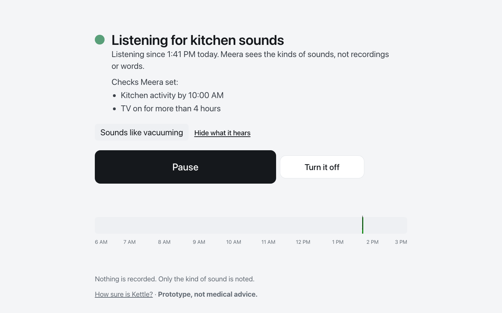

# Kettle

**Know the day went okay, without a camera.** Kettle helps an adult child who lives far from a parent with early memory loss by turning the sounds of the parent's kitchen into a private, glanceable timeline of the day. The audio never leaves the room.

[](https://colab.research.google.com/github/ThoughtTaken27/Hackathon/blob/main/notebooks/kettle_reproduce.ipynb)

| | |
|---|---|
| **Try it live** | https://kettle.parth-dev.workers.dev (the opening page plays sample days; open `/kitchen` on a laptop and `/family` on a phone to try it for real) |
| **One-page write-up** | [`docs/WRITEUP.pdf`](docs/WRITEUP.pdf) ([markdown](docs/WRITEUP.md)) |
| **Demo video (2 min)** | submitted with the entry form |
| **Reproduce every number** | [`notebooks/kettle_reproduce.ipynb`](notebooks/kettle_reproduce.ipynb) (Colab button above, about 3 min on CPU, no keys) |
| **Track** | AI + Health |

> **This project is a prototype and is not medical advice.** Kettle is not an emergency device, cannot call for help, and doesn't replace a smoke or CO detector or 911. Its urgent alerts were tested on public and synthetic clips and in a browser, never in a real emergency.

**Our user:** Meera, 34 (an invented persona), lives 300 miles from her dad Ravi, 79, who has early memory loss and lives alone. A laptop on Ravi's counter names what it hears every 10 seconds (cooking, washing up, eating, talking or TV, quiet). Meera's phone shows a calm day bar and the checks she picked ("kitchen activity by 10 AM: met at 8:05"), and turns red for a smoke alarm or a crash followed by a cry or stillness. Ravi agrees first, sees what she sees, and can pause it.

| Meera's phone ("Dad's kitchen today") | Dad's kitchen laptop |
|---|---|
|  |  |

## Results at a glance (held-out data)

| Test | Kettle | Baseline or before |
|---|--:|--:|
| Naming 9 activities, DCASE 2018 test, 7,791 clips, 91 sessions (macro F1, 95% CI) | **84.1** [74.4, 86.7] | Apple SoundAnalysis 31.8 · always "Quiet" 5.0 |
| Same, each of the 7 microphones scored alone (check across groups) | **79.9 to 85.6** | 4-mic average 85.3 |
| Kitchen activity caught, as the app shows it | **83.1%** [76.5, 90.2] | 81.1% before the kitchen detector |
| Kitchen activity missed / false alarms (counted separately) | **225 of 1,183** / **21 of 6,608** (0.3%) | 0.1% false before |
| Other homes' kitchen clips caught: Kitchen20 / DESED dish and frying | **78% / 88%** | 63% / 85% before |
| Moments labeled "Not sure" | **3.6%** | 16.3% before "Some activity" |
| Urgent caught, 60 simulated timelines each: smoke / crash + cry / crash + stillness / screaming | **88% / 73% / 72% / 83%** | |
| False urgent alerts: 12.3 h of ordinary home audio / 360 look-alikes | **0 / 0** | |

Sources: `results/metrics.json`, `web/public/data/app.json`, `results/kitchen_detector.json`, `results/describe_rule.json`, `results/safety.json`. **Where it fails:** a teammate's real kitchen read cooking with metal pots as "eating" (rules fixed, not re-run); through a simulated room and laptop mic only 28% of dish and cooking clips were caught; one research home taught it everything. Details in the write-up and on the live **How sure is Kettle?** page.

**Built during the hackathon.** All project code was written after kickoff (Fri Nov 13, 11 PM CT). The commits before kickoff are planning docs and team tooling only (`AGENTS.md`, `.claude/`, `docs/BRIEF.md`, `docs/IDEAS.md`); no code. AI tools are credited below and in [`docs/AI-USAGE-LOG.md`](docs/AI-USAGE-LOG.md).

---

The rest of this README is the detailed build log, newest first.

## Urgent alerts that reach the phone (Sun Nov 15, evening)

A smoke or CO alarm, a crash then a cry or 2 minutes of stillness, screaming, shouting again and again, a gunshot, or the
"I need help" button turns the family's view red and sends a **Web Push notification to their phone** at once, even with
Kettle closed. Person-related alerts also ask "Are you OK?" on the room screen; pressing I'm OK turns the family's banner amber.
Only the kind of sound and the time leave the room. Held-out simulator (`python -m eval.safety` → `results/safety.json`,
pre-registered in `eval/PREREGISTER-SAFETY-V35.md`; 60 timelines each, nobody answering; every window carries the activity
model's own label, as in the app):

| Urgent sound | Caught | Where the sounds came from |
|---|---|---|
| Smoke alarm during cooking | 88.3% (53/60) | synthetic NFPA 72 tones in recorded everyday sound |
| A crash, then a groan or cry | 73.3% (44/60) | public recordings joined in software |
| A crash, then 2 minutes of stillness | 71.7% (43/60) | public recordings joined in software |
| Screaming | 83.3% (50/60) | Nonspeech7k |
| Gunshot, shouting | not measured | no recordings available to us |

**False urgent alerts: 0 in 12.3 hours of ordinary home sound, and 0 in 360 look-alike timelines** (TV dramas, dropped pans,
timers, cans, knocks, fireworks). A thud alone never turns red (it fires about once an hour in ordinary homes). In a real
browser, a smoke alarm played into the microphone turned the room screen urgent after 19.9 s and the family page red 2.8 s later
(`python web/test/e2e_urgent.py`, `results/e2e_urgent.json`). A breaking-glass clip followed by 2 quiet minutes made the room
screen ask "Are you OK?" and the family page red 2.8 s later; pressing I'm OK turned it amber 4.8 s after
(`results/e2e_urgent_crash.json`). That live test first **failed**: the activity model had called the crash window "TV", which
switched off the alert. We fixed the rule (a "TV" guess must hold for 2 calm windows in a minute) and the simulator now uses the
model's own labels, which lowered the crash numbers above to what the app really does.

## Improvement round (Sat Nov 14, evening): beyond the research home

A live test in other kitchens found Kettle usually had the right activity on top but marked most windows "unlike
anything it learned", called a vacuum "Cooking", and sent general sound tags (Speech, Chewing) the consent screen didn't
promise. What changed, each measured before shipping (`python -m eval.beyond`, `python -m eval.stress`; numbers on the
How sure page under "Beyond the research home", from `results/beyond.json` and `results/stress.json`):

- **Teach Kettle this kitchen:** a 3-minute setup (quiet, washing up, cooking) with a microphone check. The windows stay on the laptop and help only sounds the model couldn't name.
- **15 named everyday sounds** (kettle, running water, alarm, glass breaking, ...), read zero-shot from the sound model; a **privacy veto** names nothing when a cough, crying or bathroom sound is loudest. The server stores only allow-listed names (no pets, phone or doorbell, matching the sound-name allow-list).
- **Plain reasons for Not sure**, a **coverage line** ("Kettle could tell what was happening for N% of the time it listened today"), a **week view**, a **"Kettle or a hot drink by 9 AM" check**, **guest pause**, **private labels** chosen by the parent, larger text, dim screen.
- **Teach-this-kitchen under stress:** `python -m eval.stress_teach` (quieter, echo, laptop mic, before/after setup).
- **Four new sample days:** Breakfast didn't happen, A visitor came, Dad paused it, Laptop closed.
- Pre-registered real-kitchen protocol: `docs/REAL-KITCHEN-PROTOCOL.md`. Threat model: `docs/THREAT-MODEL.md`.

The benchmark numbers below are unchanged: the head, θ and the novelty threshold are frozen.

## Results (every number from `results/metrics.json`; reproduce with `notebooks/kettle_reproduce.ipynb`)
<!-- results:start -->
**Held-out test (official DCASE 2018 eval sample, run once, all 7 microphones; macro F1, 95% session-bootstrap CI):**

| System | Macro F1 | N |
|---|---|---|
| **Kettle, one microphone** | **84.1 [74.4, 86.7]** | 7,791 clips / 1,113 moments / 91 sessions |
| Kettle, 4-microphone average | 85.3 [75.5, 88.1] | same |
| Apple SoundAnalysis, zero-shot | 31.8 [25.7, 37.9] | same clips |
| Same encoder, zero-shot label map | 38.5 [30.9, 47.2] | same clips |
| Always "Quiet" | 5.0 [1.6, 7.8] | same clips |
| DCASE 2018 official baseline (published) | 85.0 known mics · 83.1 unseen mics | full eval set, all dev data |
| DCASE 2018 best entry (published) | 90.4 · 88.4 | full eval set |

CIs resample the 91 test sessions (the lower end is pessimistic: some resamples lack a rare activity). Sample, scoring and microphone rule were pre-registered before any test audio was fetched; the rule couldn't identify the 3 unseen microphones, so we report all 7 together and claim no unseen-microphone number.

**Held-out, per activity (one microphone): misses and false alarms counted separately**

| Activity | Caught (recall) | Missed | False alarms | N clips |
|---|---|---|---|---|
| Quiet | 95.1 [93.1, 95.9] | 97 | 198 | 1,988 |
| Cooking | 86.1 [71.4, 93.0] | 67 | 36 | 483 |
| Washing up | 72.6 [49.5, 84.9] | 96 | 35 | 350 |
| Eating | 84.9 [75.0, 91.8] | 53 | 42 | 350 |
| Some activity | 55.4 [40.6, 73.5] | 156 | 248 | 350 |
| Conversation | 96.9 [92.5, 100.0] | 11 | 81 | 350 |
| Vacuuming | 93.1 [71.4, 100.0] | 24 | 0 | 350 |
| Talking / TV | 98.6 [97.6, 100.0] | 29 | 4 | 2,107 |
| Typing | 80.6 [72.7, 87.1] | 284 | 173 | 1,463 |

Recall fell from dev to held-out for some activity 76% → 55%, washing up 89% → 73%, eating 92% → 85%, vacuuming 100% → 93% (a different stretch of the week and other microphones; one run can't separate the causes).

Every held-out moment was heard by all 7 microphones, so differences between microphones on the same activity come from the microphone alone, its position or hardware (a post-hoc slice of the saved predictions, `results/metrics.md`): typing ranged from 63% on node 3 to 88%, while some activity was 50–60% on every microphone, so its drop isn't a microphone effect.

**Meera's check (any kitchen activity), held-out.** What the app shows after its rules and the kitchen detector: **83.1%** caught [76.5, 90.2], 0.3% false alarms (`web/public/data/app.json`). The model's raw top label alone: the top label caught **1,039 of 1,183** kitchen-activity windows (**missed 144**): 87.8% raw, **89.3%** [85.3, 94.1] reweighted. **False alarms** on **41 of 6,608** other windows: 0.62% raw, **0.5%** [0.2, 1.1] reweighted. Counts are raw; reweighted percentages re-scale each activity to the full test set's activity mix (the sample topped rare activities up to at least 50 moments each, which over-represents them), as pre-registered. Computed after the run from its saved predictions (not in the pre-registration).

**Development folds (session-disjoint, 4-fold; optimistic: the same folds chose the model):**

| System | Macro F1 | Notes |
|---|---|---|
| **Kettle, one microphone** | **85.1 [81.1, 87.4]** | N = 8,920 clips / 257 sessions |
| Log-mel statistics + logistic regression (no deep model) | 79.7 [75.5, 82.4] |  |
| CED-small (4× bigger) + same head | 85.9 [81.9, 88.1] |  |
| AST (16× bigger) + same head | 83.0 [79.1, 85.7] | seeded subset: 2700 clips (ast_subset.json); Kettle 85.5 on the same clips |
| Apple SoundAnalysis, zero-shot | 32.4 [29.9, 35.1] |  |
| AST, zero-shot label map | 38.9 [35.6, 42.7] | seeded subset: 2700 clips (ast_subset.json); Kettle 85.5 on the same clips |
| Always "Quiet" | 4.6 [3.5, 5.7] |  |

Dev, Meera's check: caught 95.3 [93.8, 96.5]% of 3,000 kitchen windows (missed 164); false alarms on 1.8 [0.7, 3.7]% of 5,920 others (106).

On 260 sounds that aren't household activities (dogs, sirens, alarms, noise, silence), Kettle gave a confident label to 0.4 [0.1, 2.1]% (vs 56.2 [50.1, 62.1]% without its 'unlike anything it learned' check).
Live, on a laptop CPU (privacy-check run, 60 s through the browser's microphone, 2 activity changes): a new activity reached the timeline after a median 4.2 s (a 10-s window must fill with the new sound); each 2-s update took 204 ms (90th percentile 1344 ms) and the server used 9% CPU on average.
Through the day bar (dev, 2-of-3 smoothing and the 30-s bridging rule, 24.78 h of stitched audio): 80.2 [74.9, 84.6]% of 257 activity sessions were caught as one block covering at least half of them, with 2.99 false-alarm blocks per hour across all activities (11.1 without smoothing).
<!-- results:end -->

Full tables, plots and the failure gallery: [`results/metrics.md`](results/metrics.md), [`results/failures.md`](results/failures.md), and the app's **How sure is Kettle?** page.

## Run it (no keys, no account, no network)

Python 3.11. About 5 minutes on a fresh machine (most of it is installing PyTorch).

```bash
git clone <this repo> kettle && cd kettle
python3.11 -m venv .venv && source .venv/bin/activate      # Windows: .venv\Scripts\activate
pip install -r requirements.txt
python smoke_test.py        # golden path, offline, < 60 s; prints PASS
python app.py               # then open http://localhost:8000 (the opening page shows both screens live)
```

- **Opening page:** http://localhost:8000/ : what Kettle is, and Dad's kitchen screen beside Meera's phone, both live. **Play a sample day** there runs on both at once.
- **Caregiver view (Meera's phone):** http://localhost:8000/today . With no kitchen laptop set up, press **Play a sample day** (real recordings from a public research home, through the same model, played fast) or **Try your own sound** (drop any audio file; it's read in memory and never saved).
- **Kitchen screen:** http://localhost:8000/kitchen on the laptop that sits in the kitchen (Chrome or Edge; the microphone needs `localhost`). The parent reads three lines, presses "Yes", and can pause or turn it off any time.
- **How sure is Kettle?** http://localhost:8000/how-sure : measured misses and false alarms per activity, from `results/metrics.json`.

Everything the model needs is in the repo: CED-tiny weights (`models/ced-tiny`, Apache-2.0), the trained head (`models/head.json`, plain numbers) and 90 sample clips (`demo_cache/`, SINS dev set, CC BY-NC 4.0).

## Setting it up for a real kitchen (two people, about 20 minutes)

1. **The kitchen laptop** (any laptop with a microphone that can stay on the counter): install as above, run `python app.py`, open **http://localhost:8000/kitchen** in Chrome, and leave the page open. The parent reads the three lines and chooses "Yes"; the browser asks once for the microphone.
2. **Keep it awake:** plug it in; turn off sleep (macOS: `caffeinate -s` in a second terminal, or System Settings → Battery → Prevent sleeping when the display is off; Windows: Power settings → Never sleep when plugged in). Keep the lid open. If it does sleep, Kettle says so: "Not listening since 10:42 AM".
3. **Seeing it from far away** (the caregiver's phone): install a free private network on both devices, e.g. [Tailscale](https://tailscale.com) (personal plan) or any WireGuard VPN, then start Kettle with `KETTLE_HOST=0.0.0.0 python app.py` and open `http://<laptop-name>:8000/today` on the phone. Only devices on that private network can reach it; nothing goes through a server of ours. On the same home Wi-Fi, `http://<laptop-ip>:8000/today` works too.
4. **Visitors:** print [`docs/COUNTER-CARD.md`](docs/COUNTER-CARD.md) and stand it by the laptop.

The caregiver's phone can read the day and set checks, but only the kitchen laptop itself can start, pause or resume listening.

## How it works

```
kitchen mic ─► 10-s windows every 2 s (RAM only) ─► CED-tiny (frozen, 192-d) ─► logistic head (9 activities)
             ─► "Not sure" below a confidence threshold ─► 2-of-3 smoothing ─► day bar blocks + evidence
             ─► caregiver checks (rules she sets: Met / Not yet / Missed / Can't tell) + heartbeat
```

## Limits (read before quoting any number)
- **One home, one person.** SINS is one adult living alone for a week, so we can't check whether Kettle works equally well across ages or sexes. Our group check is across the 7 microphones (79.9 to 85.6 macro F1) and across other homes' public clips (Kitchen20, DESED). A teammate's kitchen was an informal test, not a measured one.
- **Room and mic.** Through a simulated room and laptop mic, kitchen catch drops to 28% on DESED dish and cooking clips. Mic placement near the stove and sink matters.
- **Development numbers are optimistic**: the same folds chose the encoder, C, θ and smoothing. The held-out number is a single pre-registered run on a seeded sample of the official test set, reweighted to its class counts: close to, not exactly, a leaderboard number. Our pre-registered check could not tell which eval microphones are the 3 unseen ones, so we report all 7 together.
- **Clock times in the sample days are staged** (SINS has none); the labels are the real model's output.
- **"Kitchen activity" means kitchen sounds were heard**, not that anyone ate. Eating is hard to hear; "moving about" is the weakest class.
- **Not an emergency device.** Urgent alerts (smoke or CO alarm, crash then cry or stillness, screaming) were tested on synthetic alarms and recorded crashes mixed into home audio, never in a real emergency; gunshot and shouting have no measured catch rate.
- **Privacy proof limits:** `python -m eval.privacy_check` proves Kettle's own code writes no audio and makes no outside connections; it is not a kernel trace and can't protect against a compromised computer.

## Credits
Every dataset, model and library with links and licences: [`docs/WRITEUP.md`](docs/WRITEUP.md) (Sources), the live [Credits page](https://kettle.parth-dev.workers.dev/credits) and [`docs/DATA-SOURCES.md`](docs/DATA-SOURCES.md). AI tools: Claude Code (Anthropic) wrote most of the code and documents under our direction; Aside (Claude), an AI browser agent, built parts of the web app and ran evaluations; REA for the product teardown. Demo video: voiceover by Microsoft Edge TTS (en-US-BrianMultilingualNeural); background landscapes generated; film built in code with Aside. Who wrote what: [`docs/AI-USAGE-LOG.md`](docs/AI-USAGE-LOG.md). DESED uploader attribution: `web/public/desed-attribution.txt`.

Data: SINS / DCASE 2018 Task 5 development (CC BY-NC 4.0) and evaluation (CC BY-NC-ND 4.0) sets, KU Leuven ADVISE (Zenodo 1247102, 1291760, 1964758); ESC-50 (CC BY-NC 3.0). Models: CED-tiny / CED-small (Xiaomi, Apache-2.0), AST (MIT, BSD-3), Apple SoundAnalysis (built into macOS, baseline only). Published comparison: DCASE 2018 Task 5 results page. Libraries: PyTorch, torchaudio, transformers, scikit-learn, NumPy, SciPy, soundfile, PyAV, FastAPI, uvicorn, matplotlib, Playwright. Products studied (patterns only): Howz, Canary Care, havn, Assistiv, Apple Sound Recognition, Alexa Together, StackCare, Care Daily, Snug, Caregiver Aware, WellNest. AI tools: Claude Code (code, research, reviews), REA (teardowns), Aside (research) , every use in [`docs/AI-USAGE-LOG.md`](docs/AI-USAGE-LOG.md). Full list: [`docs/DATA-SOURCES.md`](docs/DATA-SOURCES.md). UI motion: timings for the toast, the wrong-code shake and the success check follow transitions.dev (Jakub Antalik, MIT; "Toast open/close", "Error State Shake", "Toggle"), found through devlibraries.com and hand-ported to plain CSS/JS. Motion and type values were hand-ported to plain CSS/JS, with no code copied: Magic UI (MIT): number ticker, marquee, animated beam and text blur-in timings. React Bits (MIT + Commons Clause): only the idea of the scroll word reveal. The type scale follows Arc foundation (uiarc.dev), and the tracking ramp follows published Vercel Geist and Linear values.

## Team tooling

This repo also holds the team's Claude Code setup: [`AGENTS.md`](AGENTS.md) (operating manual), `.claude/` (hooks, skills, agents), and planning docs in [`docs/`](docs/) (`PRD.md`, `DECISIONS.md`, `WRITEUP.md`, `EXPLAIN.md`, `AI-USAGE-LOG.md`, `DATA-SOURCES.md`). Commands: `/start`, `/done`, `/explain <module>`, `/checkin`, `/ship-check`.
