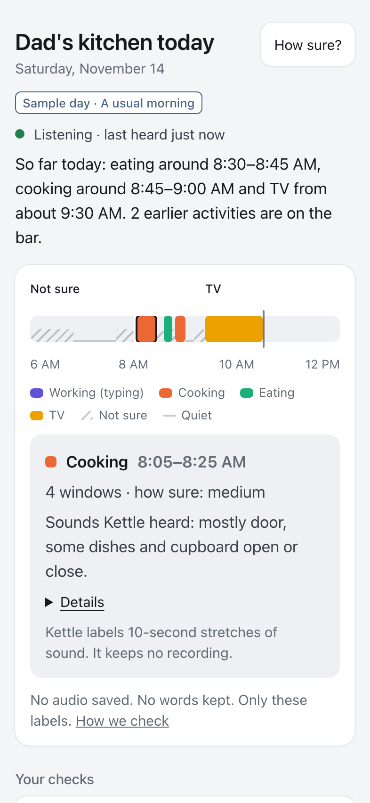

# Kettle

**A laptop already in a parent's kitchen turns household sounds into a calm day timeline for the adult child who lives far away, keeps no audio and no words, and publishes how often it misses an activity and how often it cries wolf.**

Track: AI + Health ("manage an ongoing one better"). Built for an adult child caring from a distance for a parent with early memory loss (invented persona: Meera, 34, and her father Ravi, 79, who consents on his own kitchen screen and can pause it).

> **This project is a prototype and is not medical advice.** Kettle is not an emergency device: it can't detect falls or call for help.

| Meera's phone ("Dad's kitchen today") | Dad's kitchen laptop |
|---|---|
|  |  |

<!-- lead:start -->
On the official DCASE 2018 test set (run once with a frozen model; 1,113 moments × 7 microphones = 7,791 clips from 91 sessions), Kettle scores **84.1** macro F1 (95% CI 74.4–86.7) on one microphone and 85.3 on four: level with the official 2018 baseline (85.0 known / 83.1 unseen microphones, full set) and below the best entry (90.4 / 88.4). A Mac already hears a kettle, but Apple's built-in sound classifier scores 31.8 on the same clips. Our contribution isn't the leaderboard: it's publishing every activity's misses and false alarms, and a "Not sure", consent and pause design built around them.
<!-- lead:end -->

## Results (every number from `results/metrics.json`; reproduce with `notebooks/kettle_reproduce.ipynb`)
<!-- results:start -->
**Held-out test (official DCASE 2018 eval sample, run once, all 7 microphones; macro F1, 95% session-bootstrap CI):**

| System | Macro F1 | N |
|---|---|---|
| **Kettle, one microphone** | **84.1 [74.4, 86.7]** | 7,791 clips / 1,113 moments / 91 sessions |
| Kettle, 4-microphone average | 85.3 [75.5, 88.1] | same |
| Apple SoundAnalysis, zero-shot | 31.8 [25.7, 37.9] | same clips |
| Same encoder, zero-shot label map | 38.5 [30.9, 47.2] | same clips |
| Always "Quiet" | 5.0 [1.6, 7.8] | same clips |
| DCASE 2018 official baseline (published) | 85.0 known mics · 83.1 unseen mics | full eval set, all dev data |
| DCASE 2018 best entry (published) | 90.4 · 88.4 | full eval set |

Pre-registered before any test audio was fetched (sample, scoring, microphone rule). Not confirmed by the mic-fingerprint rule; per-node numbers only, so we report all 7 microphones together; an unseen-microphone number is not claimed. The trained baselines below (log-mel, AST) were only run on the development folds.

**Held-out, per activity (one microphone): misses and false alarms counted separately**

| Activity | Caught (recall) | Missed | False alarms | N clips |
|---|---|---|---|---|
| Quiet | 95.1 [93.1, 95.9] | 97 | 198 | 1,988 |
| Cooking | 86.1 [71.4, 93.0] | 67 | 36 | 483 |
| Washing up | 72.6 [49.5, 84.9] | 96 | 35 | 350 |
| Eating | 84.9 [75.0, 91.8] | 53 | 42 | 350 |
| Moving about | 55.4 [40.6, 73.5] | 156 | 248 | 350 |
| Conversation | 96.9 [92.5, 100.0] | 11 | 81 | 350 |
| Vacuuming | 93.1 [71.4, 100.0] | 24 | 0 | 350 |
| TV | 98.6 [97.6, 100.0] | 29 | 4 | 2,107 |
| Working (typing) | 80.6 [72.7, 87.1] | 284 | 173 | 1,463 |

Recall fell from development to held-out for moving about 76% → 55%, washing up 89% → 73%, eating 92% → 85%, vacuuming 100% → 93%. The test set is a different stretch of the same week with a different mix of sessions and microphones; with only one held-out run we can't separate those causes.

**Meera's check (any kitchen activity), held-out:** caught 89.3 [85.3, 94.1]% of 1,183 windows (**missed 144**); **false alarms** on 0.5 [0.2, 1.1]% of 6,608 other windows (41). Computed after the run from its saved predictions (not in the pre-registration).

**Development folds (session-disjoint, 4-fold; optimistic: the same folds chose the model):**

| System | Macro F1 | Notes |
|---|---|---|
| **Kettle, one microphone** | **85.1 [81.1, 87.4]** | N = 8,920 clips / 257 sessions |
| Log-mel statistics + logistic regression (no deep model) | 79.7 [75.5, 82.4] |  |
| CED-small (4× bigger) + same head | 85.9 [81.9, 88.1] |  |
| AST (16× bigger) + same head | 83.0 [79.1, 85.7] | seeded subset: 2700 clips (ast_subset.json); Kettle 85.5 on the same clips |
| Apple SoundAnalysis, zero-shot | 32.4 [29.9, 35.1] |  |
| AST, zero-shot label map | 38.9 [35.6, 42.7] | seeded subset: 2700 clips (ast_subset.json); Kettle 85.5 on the same clips |
| Always "Quiet" | 4.6 [3.5, 5.7] |  |

Dev, Meera's check: caught 95.3 [93.8, 96.5]% of 3,000 kitchen windows (missed 164); false alarms on 1.8 [0.7, 3.7]% of 5,920 others (106).

On 260 sounds that aren't household activities (dogs, sirens, alarms, noise, silence), Kettle gave a confident label to 0.4 [0.1, 2.1]% (vs 56.2 [50.1, 62.1]% without its 'unlike anything it learned' check).
Through the day bar (dev, 2-of-3 smoothing, 24.78 h of stitched audio): 66.5 [60.6, 72.0]% of 257 activity sessions were caught as one block covering at least half of them, with 3.23 false-alarm blocks per hour across all activities (11.1 without smoothing).
<!-- results:end -->

Full tables, plots and the failure gallery: [`results/metrics.md`](results/metrics.md), [`results/failures.md`](results/failures.md), and the app's **How sure is Kettle?** page.

## Run it (no keys, no account, no network)

Python 3.11. About 5 minutes on a fresh machine (most of it is installing PyTorch).

```bash
git clone <this repo> kettle && cd kettle
python3.11 -m venv .venv && source .venv/bin/activate      # Windows: .venv\Scripts\activate
pip install -r requirements.txt
python smoke_test.py        # golden path, offline, < 60 s; prints PASS
python app.py               # then open http://localhost:8000
```

- **Caregiver view:** http://localhost:8000/ . With no kitchen laptop set up, press **Play a sample day** (real recordings from a public research home, through the same model, played fast) or **Try your own sound** (drop any audio file; it's read in memory and never saved).
- **Kitchen screen:** http://localhost:8000/kitchen on the laptop that sits in the kitchen (Chrome or Edge; the microphone needs `localhost`). The parent reads three lines, presses "Yes", and can pause or turn it off any time.
- **How sure is Kettle?** http://localhost:8000/how-sure : measured misses and false alarms per activity, from `results/metrics.json`.

Everything the model needs is in the repo: CED-tiny weights (`models/ced-tiny`, Apache-2.0), the trained head (`models/head.json`, plain numbers) and 90 sample clips (`demo_cache/`, SINS dev set, CC BY-NC 4.0).

## Setting it up for a real kitchen (two people, about 20 minutes)

1. **The kitchen laptop** (any laptop with a microphone that can stay on the counter): install as above, run `python app.py`, open **http://localhost:8000/kitchen** in Chrome, and leave the page open. The parent reads the three lines and chooses "Yes"; the browser asks once for the microphone.
2. **Keep it awake:** plug it in; turn off sleep (macOS: `caffeinate -s` in a second terminal, or System Settings → Battery → Prevent sleeping when the display is off; Windows: Power settings → Never sleep when plugged in). Keep the lid open. If it does sleep, Kettle says so: "Not listening since 10:42 AM".
3. **Seeing it from far away** (the caregiver's phone): install a free private network on both devices, e.g. [Tailscale](https://tailscale.com) (personal plan) or any WireGuard VPN, then start Kettle with `KETTLE_HOST=0.0.0.0 python app.py` and open `http://<laptop-name>:8000/` on the phone. Only devices on that private network can reach it; nothing goes through a server of ours. On the same home Wi-Fi, `http://<laptop-ip>:8000/` works too.
4. **Visitors:** print [`docs/COUNTER-CARD.md`](docs/COUNTER-CARD.md) and stand it by the laptop.

The caregiver's phone can read the day and set checks, but only the kitchen laptop itself can start, pause or resume listening.

## How it works

```
kitchen mic ─► 10-s windows every 2 s (RAM only) ─► CED-tiny (frozen, 192-d) ─► logistic head (9 activities)
             ─► "Not sure" below a confidence threshold ─► 2-of-3 smoothing ─► day bar blocks + evidence
             ─► caregiver checks (rules she sets: Met / Not yet / Missed / Can't tell) + heartbeat
```

## Limits (read before quoting any number)
- **One home, one person.** SINS is one adult living alone for a week, so we can't check whether Kettle works equally well across ages, sexes or households. The only other homes are two teammates' kitchens (exploratory, small N, added Sunday).
- **Development numbers are optimistic**: the same folds chose the encoder, C, θ and smoothing. The held-out number is a single pre-registered run on a seeded sample of the official test set, reweighted to its class counts: close to, not exactly, a leaderboard number. Our pre-registered check could not tell which eval microphones are the 3 unseen ones, so we report all 7 together.
- **Clock times in the sample days are staged** (SINS has none); the labels are the real model's output.
- **"Kitchen activity" means kitchen sounds were heard**, not that anyone ate. Eating is hard to hear; "moving about" is the weakest class.
- **Not an emergency device.** No fall, smoke or distress detection. No alerts are sent.
- **Privacy proof limits:** `python -m eval.privacy_check` proves Kettle's own code writes no audio and makes no outside connections; it is not a kernel trace and can't protect against a compromised computer.

## Credits
Data: SINS / DCASE 2018 Task 5 development (CC BY-NC 4.0) and evaluation (CC BY-NC-ND 4.0) sets, KU Leuven ADVISE (Zenodo 1247102, 1291760, 1964758); ESC-50 (CC BY-NC 3.0). Models: CED-tiny / CED-small (Xiaomi, Apache-2.0), AST (MIT, BSD-3), Apple SoundAnalysis (built into macOS, baseline only). Published comparison: DCASE 2018 Task 5 results page. Libraries: PyTorch, torchaudio, transformers, scikit-learn, NumPy, SciPy, soundfile, PyAV, FastAPI, uvicorn, matplotlib, Playwright. Products studied (patterns only): Howz, Canary Care, havn, Assistiv, Apple Sound Recognition, Alexa Together, StackCare, Care Daily, Snug, Caregiver Aware, WellNest. AI tools: Claude Code (code, research, reviews), REA (teardowns), Aside (research) — every use in [`docs/AI-USAGE-LOG.md`](docs/AI-USAGE-LOG.md). Full list: [`docs/DATA-SOURCES.md`](docs/DATA-SOURCES.md).

## Team tooling

This repo also holds the team's Claude Code setup: [`AGENTS.md`](AGENTS.md) (operating manual), `.claude/` (hooks, skills, agents), and planning docs in [`docs/`](docs/) (`PRD.md`, `DECISIONS.md`, `WRITEUP.md`, `EXPLAIN.md`, `AI-USAGE-LOG.md`, `DATA-SOURCES.md`). Commands: `/start`, `/done`, `/explain <module>`, `/checkin`, `/ship-check`.
